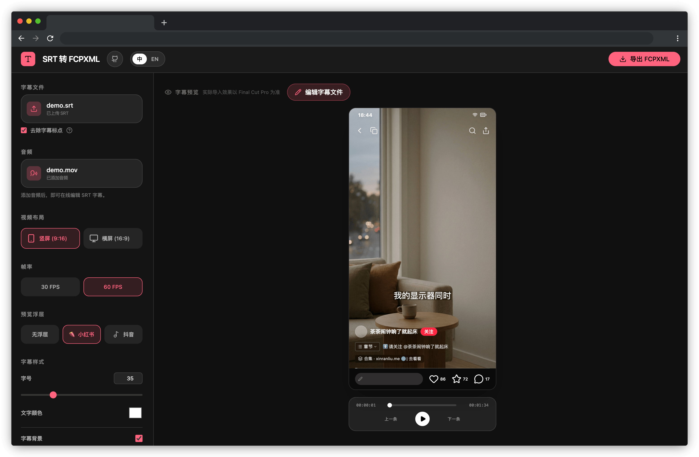

# SRT to FCPXML Converter

[中文](./README.zh-CN.md) · [User Guide](./docs/user-guide.en.md)

Convert existing `.srt` subtitles into `.fcpxml` for Final Cut Pro, with layout, review, and lightweight editing before export. Designed for desktop users who already have subtitles and want to reduce manual adjustments in FCP.

<!-- Placeholder URL: replace with the real domain once live -->
Use it online: <https://xinranliu.me/srt-to-fcpxml/>　or run it locally as described in [Local development](#local-development).



## Features

- Automatically split long subtitles based on orientation and font size; reflow all subtitles when needed.
- Portrait 9:16 (1080 × 1920) and landscape 16:9 (1920 × 1080), at 30 or 60 FPS.
- Text color and size, plus subtitle background color, opacity, corner radius, and total horizontal / vertical padding.
- RedNote and Douyin preview overlays in portrait; clean preview in landscape.
- Reference audio and waveform-assisted text editing, splitting by lines, cutting at the playhead, merging into the previous clip, and trimming timing boundaries.
- Export the current edits as FCPXML.
- Chinese and English UI.

## Quick start

1. Open the app and choose the target orientation and frame rate.
2. Import an `.srt` file. Keep or disable the default “Remove subtitle punctuation” option as needed.
3. Adjust the style and review the preview. To edit, add reference audio and choose “Edit Subtitles”.
4. Finish reviewing, choose “Export FCPXML”, and import the downloaded file into Final Cut Pro.

See the [User Guide](./docs/user-guide.en.md) for editing controls and the FCP workflow.

> Reflow All Subtitles and confirmed orientation changes rebuild the result from the original imported subtitles. They may replace manual text, splits, line breaks, and timing edits. Choose the overall layout before reviewing individual clips.

## Data and scope

- Subtitle parsing, audio processing, and export run locally in the browser without server-side media processing.
- Reference audio is used only for playback and waveforms and is not exported. Real video files are not imported.
- Export includes subtitle text. If you turn on “Subtitle Background”, the corresponding background boxes are also exported. Platform overlays are not exported.
- Exported subtitles always use PingFang SC Regular; the font cannot be changed in the app. Replace it in Final Cut Pro if your project needs another font.
- Export format is FCPXML 1.9 (Apple documents Final Cut Pro 10.4.9 or later as the requirement); keep orientation and frame rate consistent with the target project.
- Browser preview assists review; check the final font, placement, and background appearance in FCP.
- Project saving / recovery, undo / redo, and bulk movement are not available. Export the result before refreshing or leaving, and keep your source SRT.

## Local development

Requires Node.js 20 or later, plus npm. Run from the repository directory:

```bash
npm install
npm run dev
```

Open the address printed in the terminal; the default port is [3000](http://localhost:3000).

```bash
npm run lint   # TypeScript type checking
npm run build  # Production build
npm test       # FCPXML regression tests
```

Stack: React 19, TypeScript, Vite, Tailwind CSS 4, and Zustand.

Developer references: [architecture](./specs/architecture.md), [subtitle editing terminology](./specs/subtitle-editing/CONTEXT.md), and [ADRs](./specs/adr/).

## License

MIT. See [LICENSE](./LICENSE).
