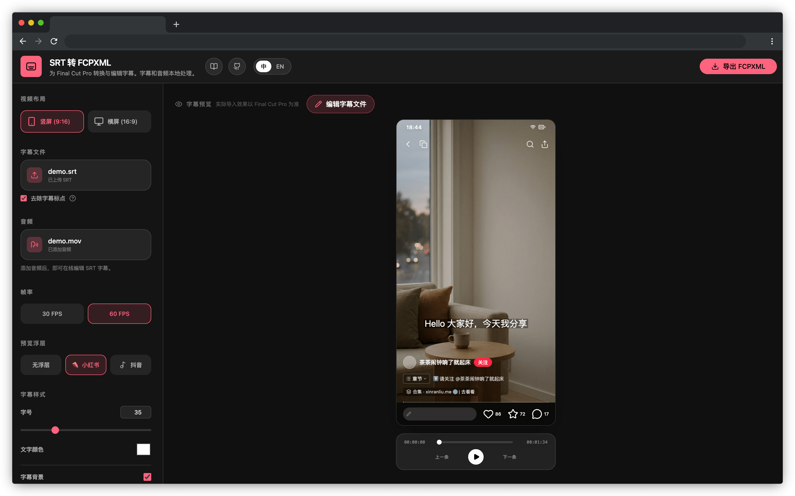

# SRT to FCPXML Converter

面向 Final Cut Pro 的浏览器字幕工具：导入 SRT、调整排版与时间，再导出 FCPXML。字幕与参考音频均在浏览器本地处理。

A browser-based subtitle tool for Final Cut Pro. Import SRT, adjust layout and timing, and export FCPXML. Subtitle and reference-audio processing runs locally in your browser.

在线使用：<https://tools.xinranliu.me/srt-to-fcpxml/>　Use it online: <https://tools.xinranliu.me/srt-to-fcpxml/>

## 核心亮点 / Highlights

- **SRT → Final Cut Pro** — 导出可导入 FCP 的字幕 / Export importable FCPXML.
- **自动字幕排版 / Automatic subtitle layout** — 横竖屏自动拆分长字幕 / Split long lines for portrait or landscape video.
- **样式预览后再导出 / Style before export** — 调整文字与圆角背景 / Customize text and rounded backgrounds.
- **听音看波形，直接改字幕 / Edit with audio waveforms** — 改字、拆分、合并、修剪时间 / Refine text, split, merge, and trim timing.
- **浏览器本地处理 / Local browser processing** — 字幕与参考音频在本机处理 / Process subtitles and reference audio on your device.

## 文档 / Documentation

| | 中文 | English |
| --- | --- | --- |
| 简介与本地运行 / Overview & local setup | [项目说明](./README.zh-CN.md) | [Project overview](./README.en.md) |
| 使用流程与编辑 / Workflow & editing | [用户指南](./docs/user-guide.zh-CN.md) | [User Guide](./docs/user-guide.en.md) |
| 生成 SRT / Generate an SRT | [如何生成 SRT](./docs/how-to-generate-srt.zh-CN.md) | [How to generate an SRT](./docs/how-to-generate-srt.en.md) |
| 在 Final Cut Pro 中使用导出的字幕 / Use Exported Subtitles in Final Cut Pro | [在 Final Cut Pro 中使用导出的字幕](./docs/final-cut-pro-workflow.zh-CN.md) | [Use Exported Subtitles in Final Cut Pro](./docs/final-cut-pro-workflow.en.md) |

## 快速流程 / Quick workflow

导入 SRT → 设置画幅与样式 → 校对（可添加参考音频进行编辑）→ 导出 FCPXML → 导入 Final Cut Pro。

Import SRT → choose orientation and style → review and edit with optional reference audio → export FCPXML → import into Final Cut Pro.

参考音频和平台预览浮层不参与导出，最终效果请在 Final Cut Pro 中检查。

Reference audio and platform preview overlays are not included in the export. Check the final appearance in Final Cut Pro.

许可 / License：MIT，详见 [LICENSE](./LICENSE)。
