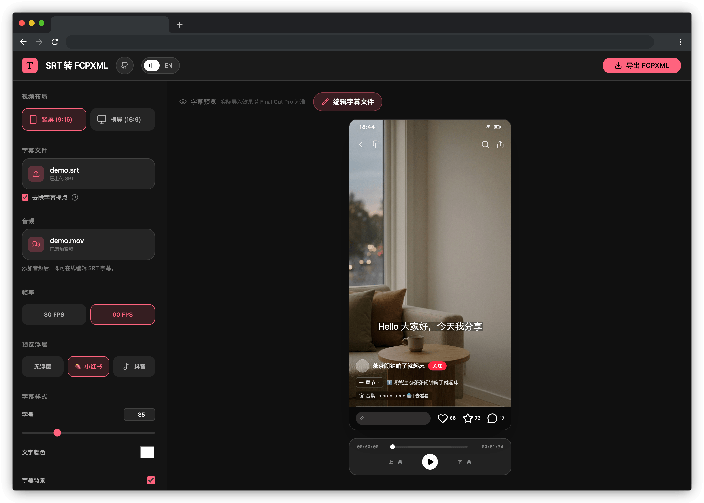

# SRT to FCPXML Converter

[English](./README.en.md) · [用户指南](./docs/user-guide.zh-CN.md)

将已有的 `.srt` 字幕转换为 Final Cut Pro 可导入的 `.fcpxml`，在导出前完成字幕排版、校对和轻量编辑。适合已经有字幕文件、希望减少 FCP 内逐条调整工作的桌面用户。

在线使用：<https://tools.xinranliu.me/srt-to-fcpxml/>　本地运行见[本地运行与开发](#本地运行与开发)。



## 核心功能

- 根据画幅与字号自动拆分长字幕，支持重新排布全部字幕。
- 支持竖屏 9:16（1080 × 1920）和横屏 16:9（1920 × 1080），以及 30 / 60 FPS。
- 调整文字颜色、字号及字幕背景的颜色、透明度、圆角和横纵总留白。
- 竖屏支持小红书、抖音浮层预览；横屏使用无浮层预览。
- 添加参考音频，结合波形编辑文字、按行拆分、按播放头切开、合并到上一句及修剪时间边界。
- 导出当前编辑结果为 FCPXML。
- 支持中文和 English 界面。

## 快速开始

1. 打开应用，选择目标视频布局和帧率。
2. 导入 `.srt`，按需要保留或关闭默认勾选的“去除字幕标点”。
3. 调整样式并检查预览；需要编辑时，添加参考音频并点击“编辑字幕文件”。
4. 完成校对后点击“导出 FCPXML”，在 Final Cut Pro 中导入下载文件。

完整操作、编辑快捷键及 FCP 使用说明见[用户指南](./docs/user-guide.zh-CN.md)。

> “重新排布全部字幕”和确认切换视频方向都会从原始导入字幕重建结果，可能覆盖手动修改的文字、拆分、换行和时间。建议先确定画幅和整体排版，再逐条校对。

## 数据与使用边界

- 字幕解析、音频处理和导出均在浏览器内完成，无需服务端处理媒体文件。
- 参考音频只用于播放和波形，不写入 FCPXML；应用不导入真实视频文件。
- 导出包含字幕文字；如果打开“字幕背景”开关，也会导出对应的背景框。平台浮层不导出。
- 导出字幕统一使用 PingFang SC Regular，应用内不提供字体切换；成片需要其他字体时，请在 Final Cut Pro 中统一替换。
- 导出格式为 FCPXML 1.9（Apple 文档标注需 Final Cut Pro 10.4.9 及以上）；画幅与帧率需与目标项目一致。
- 浏览器预览用于辅助校对，最终字体、位置和背景效果以 FCP 为准。
- 当前不提供项目保存与恢复、撤销/重做或批量移动。离开或刷新页面前请导出所需结果，并保留原始 SRT。

## 本地运行与开发

需要 Node.js 20 或更高版本及 npm。从仓库目录运行：

```bash
npm install
npm run dev
```

打开终端显示的地址，默认端口为 [3000](http://localhost:3000)。

```bash
npm run lint   # TypeScript 类型检查
npm run build  # 生成生产构建
npm test       # FCPXML 回归测试
```

技术栈：React 19、TypeScript、Vite、Tailwind CSS 4、Zustand。

开发设计见 [架构文档](./specs/architecture.md)、[字幕编辑术语](./specs/subtitle-editing/CONTEXT.md)及 [ADR](./specs/adr/)。

## 许可

MIT，详见 [LICENSE](./LICENSE)。
