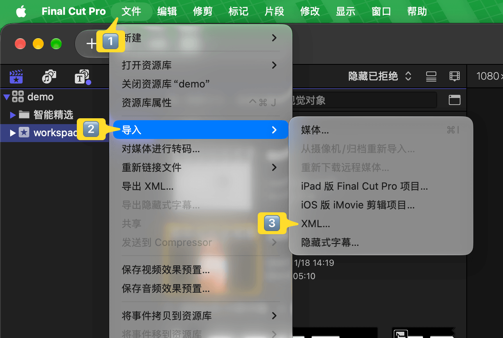
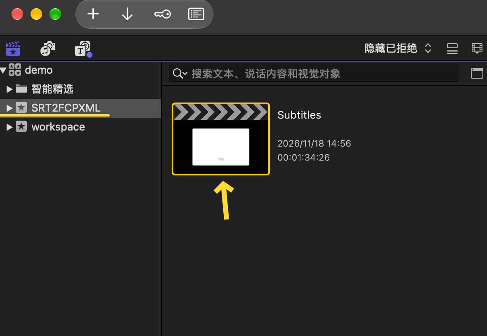
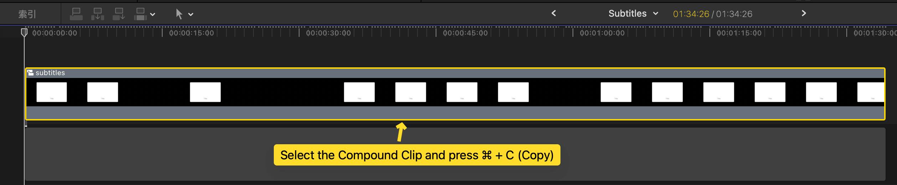
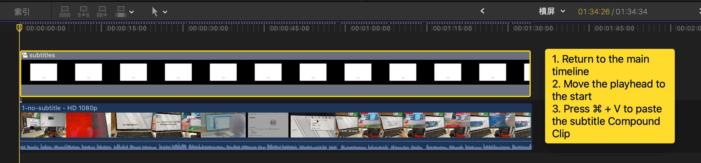
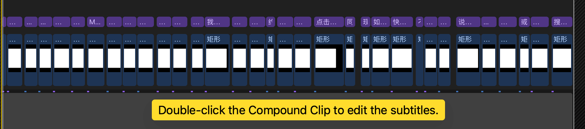

# Use Exported Subtitles in Final Cut Pro

[Back to User Guide](./user-guide.en.md) · [中文](./final-cut-pro-workflow.zh-CN.md)

Import the app’s FCPXML into Final Cut Pro for Mac, then add the subtitles to an existing video project.

## Before you start

- Finish reviewing subtitles in the app, leave editing mode, and choose “Export FCPXML” in the header.
- Match the export’s orientation and frame rate to the destination Final Cut Pro project.
- Open the library containing your destination project, with your edited video and audio ready.

The export contains a compound clip made of title clips, with optional backgrounds made using rectangle generators. These are titles, not Final Cut Pro captions. Import XML rather than using Import Captions. Reference audio, actual video, the preview background image, and platform overlays are not included.

## 1. Import the FCPXML

In Final Cut Pro, choose File > Import > XML, select the exported `.fcpxml` file, and import it. If prompted to choose a library, select the library where you want the imported items stored.

Find the `SRT2FCPXML` event in the Libraries sidebar and the `Subtitles` project in the browser. Event, project, and compound clip names remain in English regardless of the interface language.

## 2. Copy the subtitle compound clip

Double-click the `Subtitles` project in the browser to open it in the timeline.

Select the entire compound clip named `subtitles`, then press **Command-C** to copy it. Do not include the gray gap clip underneath, and do not open the compound clip to copy individual titles.

## 3. Paste into your video project

1. Double-click your actual video project in the browser to open it in the timeline.
2. Position the playhead at the point corresponding to the subtitles’ time origin. This is usually the project start.
3. Click the timeline to make it active, then press **Command-V** to paste.

Usually, align the left edge of the `subtitles` compound clip with the start of the video. For example, if the first subtitle appears at 3 seconds, the compound clip already includes those 3 seconds of empty space at the beginning. No additional adjustment is needed.

## 4. Edit text, appearance, or timing

Double-click `subtitles` in the destination project’s timeline to open the compound clip’s timeline.

- **Text and font**: Select a title clip and use the Text inspector to change its text, font, size, or color. The app exports PingFang SC Regular by default.
- **Individual timing**: Trim the start or end of the relevant title clip. If backgrounds are enabled, also trim its matching rectangle generator clip so both appear and disappear together.
- **Overall timing**: Return to the destination project and move the entire `subtitles` compound clip. Do not retime it to correct a subtitle offset.

Use the back button at the upper left of the timeline to return to the destination project.

## 5. Review and share

Play the destination project and check the first and last subtitles and several passages in between for synchronization. Check fonts, wrapping, placement, background boxes, and obstruction of the picture. Browser preview is not guaranteed to match Final Cut Pro pixel for pixel; use the Final Cut Pro viewer as the final reference.

## Troubleshooting

### What if import fails?

Select the `.fcpxml` exported by this app and use File > Import > XML. The app uses FCPXML 1.9. If Final Cut Pro reports an incompatible version, update Final Cut Pro and try again.

### What if all subtitles are early or late?

Check that the compound clip starts at the original subtitles’ time origin. Move the entire compound clip for a constant offset. If the offset grows over time, check that the subtitles match the same edit and that the export frame rate matches the project.

### Why is there no sound or actual video in the imported project?

The imported project contains only titles and optional backgrounds. Add the compound clip to your actual video project as described above, using that project’s existing video and audio.

## Apple references

- [Use XML to transfer projects](https://support.apple.com/guide/final-cut-pro/verdbd66ae/mac)
- [Connect clips](https://support.apple.com/guide/final-cut-pro/ver7a77ef9e/mac)
- [Create compound clips](https://support.apple.com/guide/final-cut-pro/verca9e8d33/mac)
