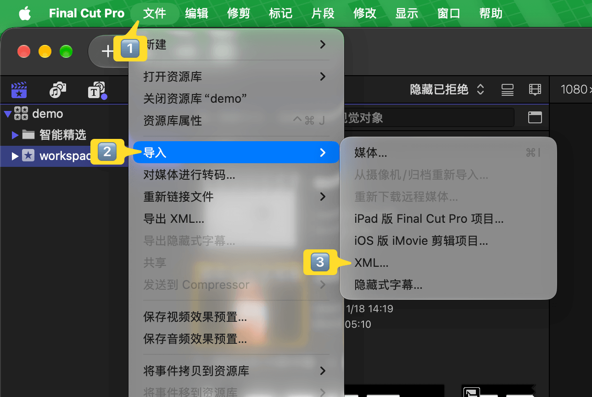
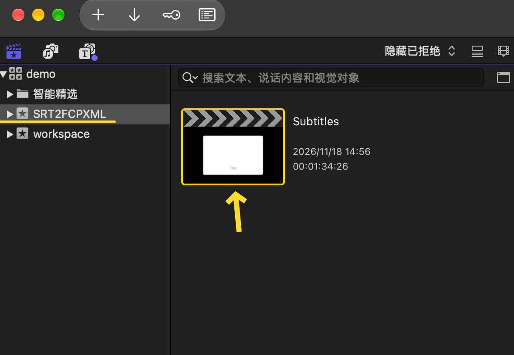
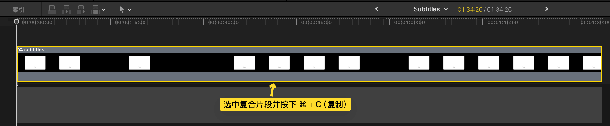
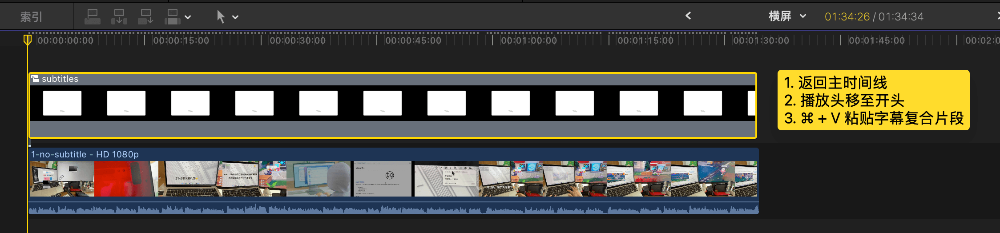
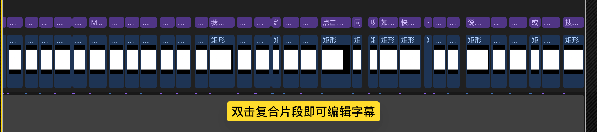

# 在 Final Cut Pro 中使用导出的字幕

[返回用户指南](./user-guide.zh-CN.md) · [English](./final-cut-pro-workflow.en.md)

本指南介绍如何将本应用导出的 FCPXML 导入 Mac 版 Final Cut Pro，再把字幕添加到已有视频项目中。

## 开始前

- 在本应用中完成字幕校对，退出编辑模式，点击顶部“导出 FCPXML”。
- 确保导出时选择的画幅和帧率与目标 Final Cut Pro 项目一致。
- 在 Final Cut Pro 中打开存放目标项目的资源库，并准备好已剪辑的视频和音频。

导出内容是由标题字幕片段组成的复合片段，可包含矩形生成器制作的背景框；它不是 Final Cut Pro 的“隐藏式字幕”。请使用 XML 导入，不要使用“导入隐藏式字幕”。参考音频、真实视频、预览背景图和平台浮层不包含在导出文件中。

## 1. 导入 FCPXML

在 Final Cut Pro 中，选取“文件”>“导入”>“XML…”，选择本应用导出的 `.fcpxml` 文件并导入。如果出现资源库选择提示，选择要存放导入内容的资源库。

导入后，在资源库边栏中找到事件 `SRT2FCPXML`，并在浏览器中找到项目 `Subtitles`。事件、项目和复合片段的名称保持英文，不随界面语言切换。

## 2. 拷贝字幕复合片段

双击浏览器中的 `Subtitles` 项目，在时间线中打开它。

单击选中名为 `subtitles` 的整个复合片段，按 **Command-C** 拷贝。不要把下方灰色的间隙片段一起选中；也不需要进入复合片段逐条拷贝字幕。

## 3. 粘贴到目标视频项目

1. 在浏览器中双击你实际剪辑的视频项目，在时间线中打开它。
2. 将播放头移到字幕时间起点对应的位置。通常是项目开头。
3. 点按时间线使其处于活跃状态，按 **Command-V** 粘贴。

通常，将 `subtitles` 复合片段的左边缘对齐视频开头即可。例如，第一句字幕在第 3 秒出现，复合片段开头就已包含这 3 秒空白，不需要再移动字幕。

## 4. 修改文字、样式或时间

双击目标项目时间线中的 `subtitles` 复合片段，打开其内部时间线。

- **修改文字与字体**：选中对应的标题字幕片段，在文本检查器中修改文字、字体、字号或颜色。应用导出的默认字体为 PingFang SC Regular。
- **调整单句时间**：修剪对应标题字幕片段的起点或终点。启用了背景时，同时调整对应的矩形生成器片段，确保背景与文字同时出现和消失。
- **整体调整时间**：返回目标项目时间线，移动整个 `subtitles` 复合片段。不要通过改变复合片段的播放速度校正字幕偏移。

完成后，使用时间线左上方的返回按钮回到目标项目。

## 5. 检查并输出成片

播放目标项目，检查第一句、最后一句和中间几处对白，确认同步；再检查字体、换行、位置、背景框以及画面遮挡。浏览器预览不保证与 Final Cut Pro 像素级一致，以 Final Cut Pro 检视器中的结果为准。

## 常见问题

### 导入失败怎么办？

确认选择的是本应用导出的 `.fcpxml`，并通过“文件”>“导入”>“XML…”导入。应用使用 FCPXML 1.9；如果 Final Cut Pro 提示版本不兼容，先更新 Final Cut Pro 后重试。

### 字幕整体提前或延后怎么办？

先检查复合片段的起点是否对齐原始字幕的计时起点。如果偏移量固定，移动整个复合片段；如果越往后偏差越大，检查字幕是否对应同一个剪辑版本，以及导出帧率是否匹配。

### 为什么没有声音，或者单独打开时看不到真实视频？

导入的项目只包含字幕及可选背景。按上述步骤将复合片段添加到真实视频项目，使用该项目已有的视频和音频。

## Apple 官方参考

- [使用 XML 传输项目](https://support.apple.com/zh-cn/guide/final-cut-pro/verdbd66ae/mac)
- [连接片段](https://support.apple.com/zh-cn/guide/final-cut-pro/ver7a77ef9e/mac)
- [创建复合片段](https://support.apple.com/zh-cn/guide/final-cut-pro/verca9e8d33/mac)
