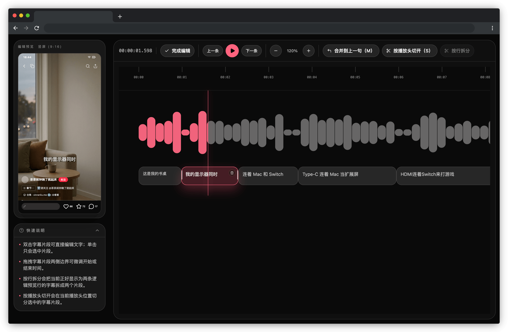

# User Guide

[Project overview](../README.en.md) · [中文](./user-guide.zh-CN.md)

Start with an existing SRT, review its layout and timing, and export FCPXML for Final Cut Pro. Use a desktop browser; see the project overview for local setup.

## 1. Prepare files and layout

Prepare a timed `.srt` file; if you do not have one yet, see [How to generate an SRT](./how-to-generate-srt.en.md). For listening and timeline editing, also prepare reference audio with the same time origin as the subtitles. Audio is optional for conversion and export.

Choose the target orientation and frame rate first:

| Setting | Options | Purpose |
| --- | --- | --- |
| Video Layout | Portrait 9:16 / Landscape 16:9 | Preview aspect ratio, automatic layout width, and export resolution |
| Frame Rate | 30 / 60 FPS | Subtitle frame boundaries and export frame rate; match the target project |
| Preview Overlay | None / RedNote / Douyin | Check platform UI obstruction; platform overlays are portrait-only and are not exported |

Set the overall orientation, font size, and layout before editing individual clips.

## 2. Import subtitles and handle punctuation

Choose an `.srt` file in the upload area. The app automatically splits long subtitles and creates the preview.

“Remove subtitle punctuation” is enabled by default. Processing preserves manual line breaks, apostrophes and hyphens within Latin words, and numeric formatting symbols within numbers. Chinese punctuation is removed; punctuation between English words becomes a space. Punctuation-only clips may become empty time ranges.

Toggling this option does not immediately change existing subtitles. To apply it, choose “Reflow All Subtitles” and confirm. Disabling the option and reflowing restores punctuation from the original import, but also rebuilds other editing results.

## 3. Style and preview

Adjust font size and text color. To add a background to subtitles, turn on “Subtitle Background”, then adjust its color, opacity, corner radius, and total horizontal / vertical padding. Total padding is the combined space on both sides of that axis.

Each box is sized for its subtitle and appears only for that subtitle's duration. Subtitle backgrounds are exported; the preview background image and platform overlays are not.

Font size affects preview rendering and export parameters only; it does not re-split existing clips. To wrap long lines again at the new size, run “Reflow All Subtitles” once more.

Use playback and Previous / Next to review subtitles. Exported subtitles always use PingFang SC Regular, and the app does not offer a font picker. Browser and FCP font and background rendering can differ. Preview assists review; verify the final result in FCP, and replace the font in FCP if your project needs another one.

## 4. Add reference audio and edit

After importing subtitles, choose “Add Reference Audio”. Common audio formats are supported, and you can also select an `.mp4` or `.mov` video file; the app reads its audio track. Wait for waveform generation, then choose “Edit Subtitles” to enter Subtitle Editing Mode.

Reference audio supports playback synchronization and the Waveform Timeline and is not included in the export. Check that it shares the subtitles' time origin. Replacing or removing the reference audio exits Subtitle Editing Mode and returns to the main workspace.

| Action | How to use it |
| --- | --- |
| Select a clip | Single-click; selection changes without moving the playhead |
| Edit text | Double-click; Enter commits, Shift+Enter inserts a line break, Escape cancels the current text edit; leaving the text field also commits |
| Split by Lines | Available when the selected clip has exactly two logical preview lines; creates two clips |
| Cut at Playhead | Select a clip, place the playhead inside it, then use the button or press S |
| Merge into Previous | Select an eligible clip, then use the button or press M |
| Trim timing | Drag the left or right clip edge to adjust its start or end |
| Leave editing | Choose “Done Editing” to return to the main workspace |

S / M operate on the timeline outside text input. If a button is unavailable, finish text editing and check the selected clip and playhead position.

Cut at Playhead estimates the text split from the time ratio. It may cut within an English word and is not word-level audio alignment. Listen and check the resulting text. Pausing or seeking on the timeline selects the subtitle at the playhead; a gap clears selection.

## 5. Understand reflow

“Reflow All Subtitles” (Subtitle Reflow) rebuilds the Working Timeline from the original imported subtitles. Confirming an orientation change also triggers this process.

Reflow may replace edited text, splits, line breaks, merges, and timing boundaries. It does not simply wrap the current edits again. Complete global layout work before individual edits. Export an FCPXML first if you need to preserve a usable result; that export is for FCP, not a project backup that this app can reopen.

## 6. Export and use in Final Cut Pro

After reviewing, leave editing mode and choose “Export FCPXML” in the header. To learn how to use the exported FCPXML file in Final Cut Pro, see the separate [Final Cut Pro Workflow](./final-cut-pro-workflow.en.md) guide.

## Troubleshooting

### Why is editing unavailable?

Both imported subtitles and reference audio are required. Export directly if you do not need editing.

### Why did edited text disappear after reflow?

Reflow rebuilds from the original import rather than preserving manual edits as input. Confirming an orientation change does the same.

### Why is there no audio or platform UI in the export?

Reference audio and overlays assist review only. Export contains subtitles and optional backgrounds.

### Can I export edited SRT or save a project for later?

The export format is FCPXML. SRT export and project saving / recovery are not available. Keep the original SRT and export your result before refreshing or leaving the page. Undo / redo is also unavailable.

### What if FCP looks different from the preview?

Check orientation, frame rate, and font rendering, then subtitle placement and backgrounds. Browser preview is not guaranteed to match FCP pixel for pixel; use the FCP result as the final reference.
