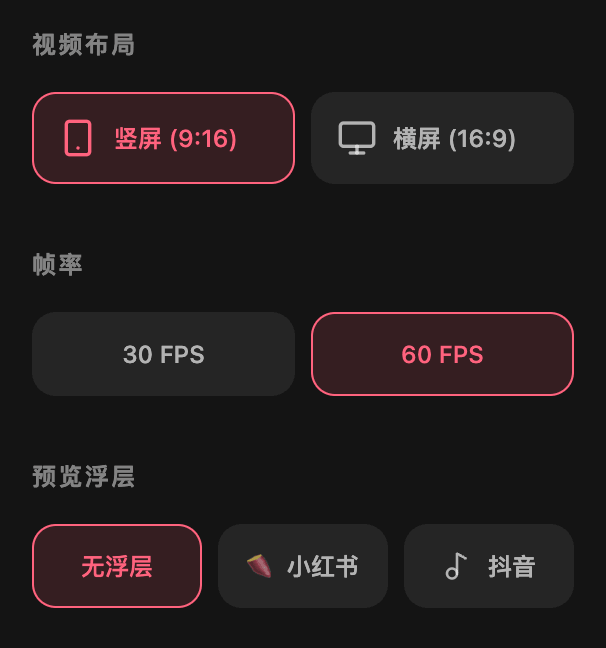
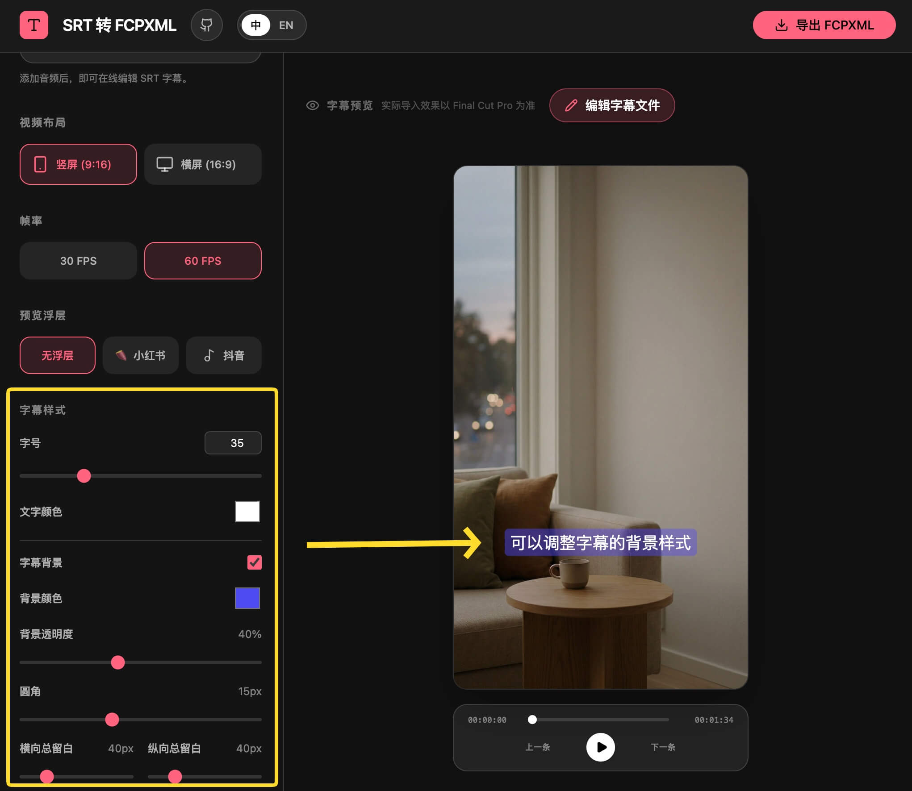
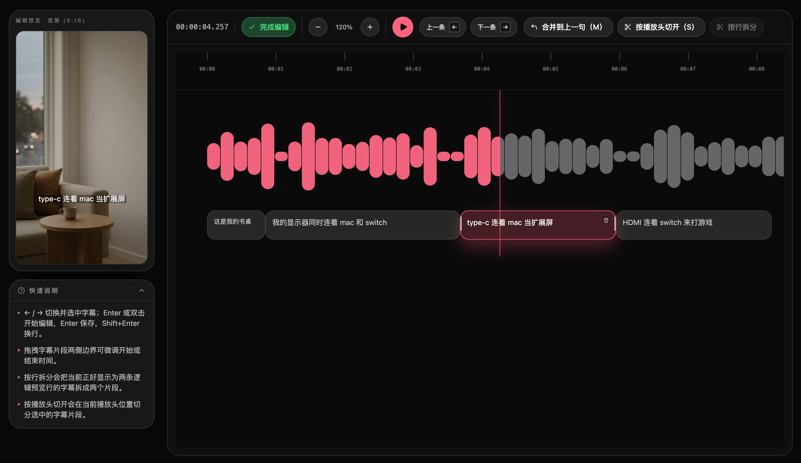

# 用户指南

[项目说明](../README.zh-CN.md) · [English](./user-guide.en.md)

本指南帮助你从已有 SRT 出发，完成排版、校对和编辑，导出供 Final Cut Pro 使用的 FCPXML。使用桌面浏览器；本地启动方法见项目说明。

## 1. 准备文件与布局

准备一份带时间码的 `.srt` 文件；还没有字幕文件时，可参考[如何生成 SRT](./how-to-generate-srt.zh-CN.md)。需要听音校对和时间线编辑时，再准备与字幕时间起点一致的参考音频（界面中称为“关联音频”）。参考音频是可选的，直接转换与导出不需要音频。

先选择目标视频布局和帧率：

| 设置 | 选项 | 作用 |
| --- | --- | --- |
| 视频布局 | 竖屏 9:16 / 横屏 16:9 | 决定预览比例、自动排布宽度及导出分辨率 |
| 帧率 | 30 / 60 FPS | 决定字幕时间的帧边界与导出帧率，应与目标项目匹配 |
| 预览浮层 | 无浮层 / 小红书 / 抖音 | 辅助检查平台界面遮挡；平台浮层仅适用于竖屏，不导出 |

建议先确定画幅、字号与整体排版，再进行逐条编辑。

## 2. 导入字幕与处理标点

点击字幕上传区域选择 `.srt`。应用会自动拆分过长字幕并生成预览。

“去除字幕标点”默认勾选。处理会保留手动换行、拉丁单词内部的撇号和连字符，以及数字内部的格式符号；中文标点直接移除，英文词间标点以空格分隔。只包含标点的片段可能成为空白时段。

切换该选项不会立即改变已经显示的字幕。需要应用到当前字幕时，执行“重新排布全部字幕”并确认。关闭选项后重新排布，可从原始导入内容恢复标点，但也会重建其他编辑结果。

## 3. 调整样式并预览

设置字号和文字颜色；如需为字幕添加背景，打开“字幕背景”开关，调整颜色、透明度、圆角和横纵总留白。总留白表示该方向两侧合计的空间。

背景框按每条字幕的内容和样式计算尺寸，并随该条字幕出现、消失。背景会参与导出；预览背景图和平台浮层不参与导出。

字号只影响预览渲染和导出参数，不会重新拆分已有片段。要让长句按新字号重新拆行，需要再执行一次“重新排布全部字幕”。

使用播放控制和上一条 / 下一条检查字幕。导出字幕统一使用 PingFang SC Regular，应用内不提供字体切换。浏览器与 FCP 的字体和背景渲染可能不同，预览用于校对，最终结果需在 FCP 中确认；成片需要其他字体时，请在 FCP 中统一替换。

## 4. 添加参考音频并编辑

导入字幕后，点击“添加关联音频”。支持常见音频格式，也可以直接选择 `.mp4` / `.mov` 视频文件，应用会读取其中的音轨。等待波形生成，再点击预览区的“编辑字幕文件”，进入字幕编辑模式（Subtitle Editing Mode）。

参考音频用于播放同步与波形时间线（Waveform Timeline），不会被写入导出文件。听音时先确认音频与字幕的时间起点一致。替换或移除参考音频会退出字幕编辑模式，回到主界面。

| 操作 | 使用方式 |
| --- | --- |
| 选择字幕 | 单击片段，只改变选择，不移动播放头 |
| 编辑文字 | 双击片段；Enter 提交，Shift+Enter 换行，Escape 取消本次文字修改；离开输入框也会提交 |
| 按行拆分 | 选中字幕在当前逻辑预览中恰好为两行时可用，将其拆为两个片段 |
| 按播放头切开 | 选择片段，将播放头放在片段内部，点击按钮或按 S |
| 合并到上一句 | 选择可合并的片段，点击按钮或按 M |
| 修剪时间 | 拖拽片段左侧或右侧边界，调整开始或结束时间 |
| 退出编辑 | 点击“完成编辑”，返回主界面 |

S / M 用于时间线操作，不用于文字输入期间。按钮不可用时，先结束文字编辑，再检查片段选择与播放头位置。

暂停或在时间线上定位后，应用会按播放头位置选择字幕；落在空白时段则清除选择。

> **注意**：“按播放头切开”的文字切点按时间比例估算，可能切在英文单词内部，并不代表逐字音频对齐。切开后应听音检查文字分配。

## 5. 理解重新排布

“重新排布全部字幕”（Subtitle Reflow）以最初导入的字幕内容重新生成工作字幕时间线（Working Timeline）。确认切换视频方向也会执行这一过程。

这可能覆盖已经改过的文字、拆分、换行、合并和时间边界。它不是只对当前编辑结果重新换行。建议在逐条编辑前完成全局排布；如果需要保留当前可用成果，先导出一份 FCPXML。导出文件用于 FCP，不是可重新打开的本应用项目备份。

## 6. 导出与 Final Cut Pro 工作流

完成校对后，退出编辑模式，点击顶部“导出 FCPXML”。如何在 Final Cut Pro 中使用导出的 FCPXML 文件，请查看独立的 [在 Final Cut Pro 中使用导出的字幕](./final-cut-pro-workflow.zh-CN.md)文档。

FCPXML 包含当前工作字幕时间线的字幕文字；如果打开“字幕背景”开关，也会导出对应的背景框。参考音频、真实视频和平台浮层不参与导出，真实媒体仍由你在 FCP 中管理。

## 常见问题

### 为什么不能进入编辑？

需要同时有已导入字幕和参考音频。无需编辑时，可直接导出。

### 为什么重新排布后改过的文字消失了？

重新排布从原始导入字幕重建结果，手动修改不会作为输入保留。切换画幅并确认时同样如此。

### 为什么导出的文件没有声音或平台界面？

参考音频与浮层仅用于校对；导出范围是字幕及可选背景。

### 可以导出修改后的 SRT，或保存项目继续编辑吗？

当前导出格式为 FCPXML，不提供 SRT 导出或项目保存与恢复。保留原始 SRT，并在离开或刷新页面前导出所需结果。当前也不支持撤销/重做。

### FCP 中的效果和预览不同怎么办？

先核对画幅、帧率及字体显示，再检查字幕位置和背景。浏览器预览不保证与 FCP 像素级一致；以 FCP 实际结果为准。
